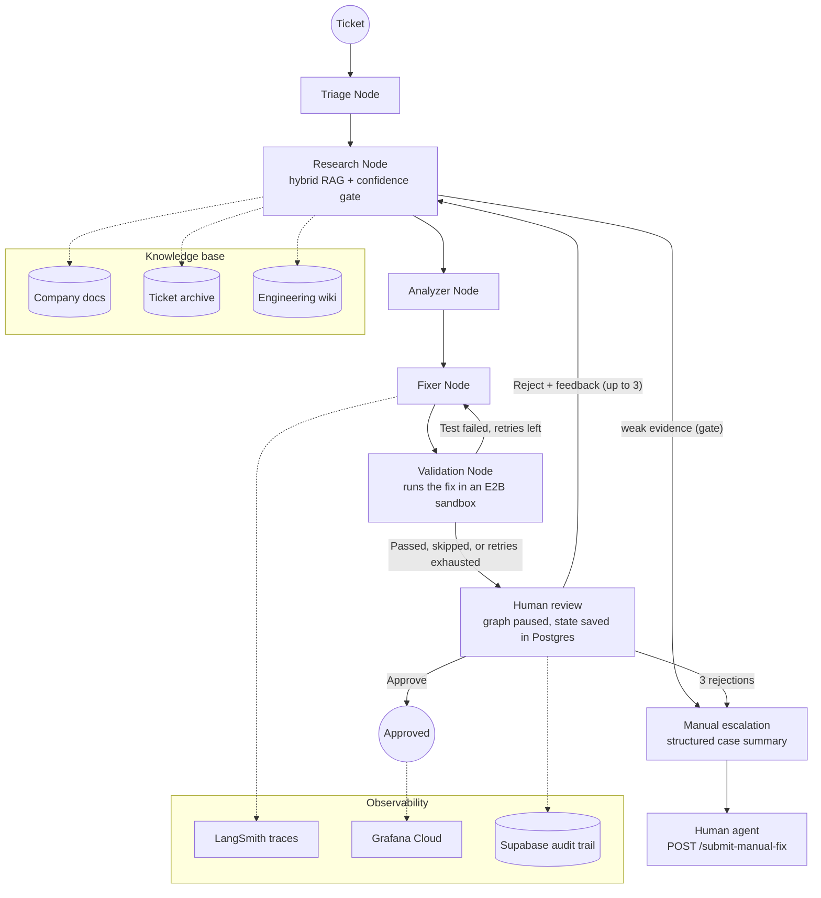
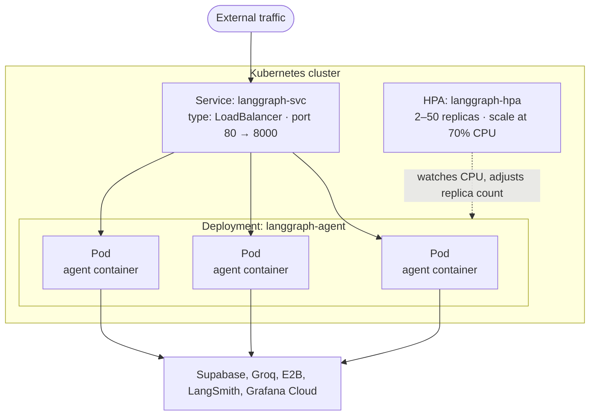

# Self-Healing AI Customer Support Agent

**A support agent that tests its own fixes before a human ever sees them.** It retrieves evidence with a production-style hybrid RAG pipeline, runs the proposed fix in an isolated sandbox and feeds any error back to the model, then hands the result to a human reviewer who can approve, reject with feedback, or escalate. When the knowledge base cannot answer, it refuses to guess.


---

## At a glance

| | Result | Where it was measured |
|---|---|---|
| **Retrieval quality** (10 held-out questions) | hit@1 **80%** · hit@5 **100%** · MRR **0.90** (release 1: 60% · 90% · 0.73) | Hand-labelled golden set, 30 questions |
| **Confidence gate** | **0 of 10** held-out questions wrongly refused · **12/12** unseen out-of-scope questions refused | Offline gate evaluation |
| **Speed** | median **17.5 s** from ticket to proposed fix (p95 27 s) | 20-ticket live test |
| **Cost** | about **$0.0005** of LLM cost per ticket (Groq list pricing) | LangSmith traces |
| **Human review** | durable pause and resume; approval resumes in about **8 s** | Postgres checkpoints |
| **Auditability** | 5 Supabase tables, about 6.5 logged steps per ticket | Supabase rows |

All numbers come from the evaluation scripts and saved results in [`evaluation/`](evaluation/). See [Measured results](#measured-results) for the method and the caveats.

---

## See it work in 60 seconds

```bash
# 1. Submit a ticket (answerable from the knowledge base)
curl -X POST http://localhost:8000/ticket/stream -H "Content-Type: application/json" -H "x-api-key: $APP_API_KEY" \
  -d '{"customer_message": "api keeps giving me 401, im sending my key in X-API-Key header"}'
#  -> status: "pending_review", with a proposed fix and the sandbox test result

# 2. Reject the draft with feedback: the agent researches again and writes a new draft
curl -X POST http://localhost:8000/review -H "Content-Type: application/json" -H "x-api-key: $APP_API_KEY" \
  -d '{"ticket_id": "TICKET-XXXXXXXX", "human_approved": false, "human_feedback": "Show a full curl example and explain key rotation."}'

# 3. Approve the revised draft
curl -X POST http://localhost:8000/review -H "Content-Type: application/json" -H "x-api-key: $APP_API_KEY" \
  -d '{"ticket_id": "TICKET-XXXXXXXX", "human_approved": true, "human_feedback": "Perfect."}'
#  -> status: "approved"

# A question the docs cannot answer is escalated instead of guessed
curl -X POST http://localhost:8000/ticket/stream -H "Content-Type: application/json" -H "x-api-key: $APP_API_KEY" \
  -d '{"customer_message": "do you integrate with PayPal for subscriptions?"}'
#  -> status: "escalated", reason: "Not enough information in the docs. Sent to a human."
```

Interactive docs are at `http://localhost:8000/docs` once the server is running (see [Quick start](#quick-start)).

---

## Why this project

Most support bots answer from a script and stop when they are wrong, or answer fluently from nothing. This project is built around four ideas:

1. **Evidence before generation.** A confidence gate sits between retrieval and the LLM. If the best evidence is weak, the ticket goes to a human; the model never gets the chance to improvise.
2. **Execution as feedback.** A proposed fix is not trusted until its code has actually run. Errors from an isolated sandbox go straight back to the Fixer for another attempt.
3. **Humans in the loop, durably.** Review is a real state of the workflow: the graph pauses with its state saved in Postgres, and resumes on approve or reject, even after a restart.
4. **Everything is measured and logged.** Each step is written to a five-table audit trail and traced in LangSmith, and the project ships the scripts used to evaluate it.

---

## How it works



| Step | What happens |
|---|---|
| **Triage** | An LLM classifies the ticket by type, severity and technical domain. |
| **Research (RAG)** | Hybrid retrieval pulls the most relevant docs, wiki entries and similar past tickets. The confidence gate stops weak evidence from reaching the model. |
| **Analyzer** | Combines the triage result and the evidence to find the likely root cause and the kind of fix needed (code, configuration, or a system-level bug). |
| **Fixer** | Produces a concrete solution, including corrected code when the fix needs it. |
| **Validation (E2B)** | Runs the proposed Python in an isolated sandbox. Results: `passed`, `failed`, `skipped` (nothing to run, or not valid Python) or `error` (the sandbox itself broke). Only a real code failure counts as an attempt. |
| **Adaptive routing** | A failed run loops back to the Fixer with the execution error (up to 3 attempts). A passing, skipped or exhausted run goes to human review. |
| **Human review** | The graph pauses with its state checkpointed in Postgres. Approve finishes the ticket. Reject with feedback re-runs research with that feedback. After 3 rejections the ticket is escalated with a structured case summary. |
| **Escalation** | Tickets with weak evidence, or 3 rejections, wait in `GET /pending-escalations` and are closed with `POST /submit-manual-fix`. |

---

## Production RAG

The retrieval layer was built and evaluated on its own before it was wired into the agent.

| Stage | What it does |
|---|---|
| Chunking | Heading-aware splitting of the three markdown sources in `data/` (174 chunks) |
| Vector search | Dense retrieval from a persistent ChromaDB index, top 30 candidates |
| BM25 | Keyword retrieval over the same chunks, top 30 candidates |
| RRF fusion | Reciprocal Rank Fusion merges the two ranked lists |
| Cross-encoder rerank | A cross-encoder rescores the merged candidates and keeps the best 5 |
| Confidence gate | If the best rerank score is below the calibrated threshold (−5.0), no context is passed to the LLM and the ticket is escalated |

### Retrieval quality

Measured on a hand-labelled golden set of 30 questions, 10 of them held out (never used for tuning), across two tagged releases of the retrieval pipeline:

| Held-out metric | Release 1 | Release 2 |
|---|---|---|
| hit@1 | 60% | **80%** |
| hit@5 | 90% | **100%** |
| MRR | 0.73 | **0.90** |

### Confidence gate

The threshold was calibrated on the development questions plus a small set of out-of-scope questions, then checked offline (retrieval layer only, no LLM) on questions it had never seen:

| Question group | Result |
|---|---|
| 10 held-out in-scope questions | **0 wrongly refused** |
| 12 unseen out-of-scope questions (about half off-topic, half close to the product's domain) | **12/12 refused** |
| 5 out-of-scope calibration questions | 5/5 refused (used to set the threshold, so in-sample) |

The margin is real but not huge: the weakest out-of-scope best-score was −6.4 and the lowest in-scope best-score was −3.9, against a threshold of −5.0. The 12 unseen questions were written by the author, so treat this as a sanity check, not a benchmark.

---

## Human-in-the-loop and escalation

- **Durable state.** The LangGraph checkpointer (`AsyncPostgresSaver`) stores graph state in Supabase Postgres, so a paused ticket survives a restart.
- **Approve.** `POST /review` with `human_approved: true` finishes the ticket and records the approved solution.
- **Reject with feedback.** `human_approved: false` plus `human_feedback` sends the ticket back to research; the new draft takes the feedback into account.
- **Escalate.** After 3 rejections, or when the gate refuses weak evidence, the ticket is marked `escalated` with a structured summary and waits for a person.
- **Close manually.** `POST /submit-manual-fix` lets a human agent write the final fix and resolve the ticket.

---

## Engineering notes

**The gate is a design choice, not an afterthought.** Letting the LLM decide whether it has enough evidence is exactly where hallucinations come from. A numeric score from the cross-encoder, calibrated on held-out data, is a decision that can be measured and tuned.

**Hybrid retrieval, because queries look different.** Exact identifiers (error codes, header names) favour keyword search, while paraphrased questions favour embeddings. RRF merges the two lists without having to calibrate their scores against each other, and the cross-encoder re-scores the merged candidates for precision.

**Review is workflow state, not a bolt-on.** Pausing the graph before the review node with a Postgres checkpointer means a human decision can arrive minutes or days later, from another process.

**Execution feedback is a signal, not a rubber stamp.** The sandbox distinguishes a crash in the proposed code (`failed`, retried) from nothing to run (`skipped`) and from the sandbox itself breaking (`error`, which says nothing about the code and is not counted as an attempt).

**Cost is bounded at every level.** At most 3 sandbox attempts per draft, at most 3 human rejections per ticket, and at most 5 retries on any single LLM call for transient errors. That is what keeps the median cost near $0.0005 per ticket.

**Measure, then fix.** The live test below exposed a real bug (structured output returning `null` for an optional list), which was fixed and re-measured instead of being hidden.

---

## Database and audit trail

Supabase (PostgreSQL) holds a five-table audit trail:

| Table | Purpose |
|---|---|
| `tickets` | One row per ticket: message, status, classification, root cause, proposed fix, test result, human decision and feedback, escalation summary |
| `ticket_draft` | Each draft shown to the human reviewer, with the review decision and feedback |
| `solution` | The accepted solution: fix, explanation, test result, risk estimate, attempt number, approval |
| `agent_step` | Node-level log: input, output, attempt count and error text for every step of the graph |
| `metrics` | Daily aggregate counts |

LangGraph creates its own checkpoint tables automatically on first start. For tickets waiting on a human, `human_approved` stays empty until someone acts, and `human_feedback` reads "Awaiting human agent" in the meantime.

---

## Measured results

A 20-ticket live test run through the real API against Supabase, Groq and E2B, executed twice: once before and once after a reliability fix. Metrics come from LangSmith traces, Supabase rows and server logs. The mix: 10 held-out in-scope questions, 5 out-of-scope questions, 3 code tickets and 2 reject-then-retry tickets.

### Behaviour

| Check | Result (after fix) |
|---|---|
| In-scope held-out questions that produced a draft | 10/10 |
| Out-of-scope questions escalated by the gate | 5/5 (calibration set, in-sample) |
| Code tickets passing the E2B sandbox | 2/3 (the third had no related docs and was escalated by the gate) |
| Reject → revised draft → approve | 2/2 produced a revised draft |
| Errors on ticket submission | 0/20 (before the fix: 1/20) |

### Performance and cost

| Metric | Value |
|---|---|
| Ticket to proposed fix (AI-drafted tickets) | **median 17.5 s, p95 27 s** |
| Escalation by the gate | about 11 s |
| Approval resume (`/review`) | median 7.6 s (a reject re-runs research and takes about 20 s) |
| LLM cost per ticket (LangSmith, Groq list pricing) | **median about $0.0005** (about $0.010 for 20 tickets) |
| Tokens per ticket | about 4k |
| Audit-trail steps logged | 129 for 20 tickets (about 6.5 per ticket) |

### A bug the test found

The first run showed the Fixer's structured output sometimes returning `null` for optional list fields, which the schema rejected, and one ticket exhausted its retries and returned an HTTP 500. The fix in `backend/agent.py` lets the schema accept `null` and converts it to an empty list, and makes the retry wrapper also retry output-parser errors.

| | Before | After |
|---|---|---|
| Failed LLM calls (LangSmith) | 12 over 19 tickets (0.63 per ticket) | 8 over 20 tickets (0.40 per ticket) |
| Tickets needing at least one retry | 6 of 19 | 4 of 20 |
| `null`-array schema failures | recurring | 0 |

### How to read these numbers

- **Small sample.** 20 tickets, run twice, by one person. This is a behaviour check, not a production benchmark.
- **Scripted approvals.** The human approvals were automated, so the numbers show how the system behaves, not how good the answers are. Answer quality is covered by the retrieval evaluation above.
- **Provider limits.** The Groq free tier has a daily token cap. It was reached at the end of the second run, and one `/review` call returned a 500 because of it.
- **Failure counts are noisy.** Going from 12 to 8 failed calls is a small change in a random process. The clear result is that the specific `null` failure disappeared.
- **No external baselines.** v1 shipped an illustrative comparison chart; it is replaced here by real measurements, and there is no head-to-head against manual support or other bots.

---

## Quick start

**Prerequisites:** Python 3.11, and your own keys for Groq, E2B and a Postgres database such as Supabase. Docker and Kubernetes are optional.

```bash
git clone https://github.com/MuhammadAbbas01/Self_Healing_Customer_support_agent.git
cd Self_Healing_Customer_support_agent
pip install -r requirements.txt
cp .env.example .env          # fill in your keys (never commit .env)
# create the five tables in your Postgres/Supabase project (see "Database and audit trail")
python backend/main.py        # run from the project root
```

On first run the app chunks and embeds the three files in `data/` into ChromaDB and downloads the embedding and reranker models, so allow a couple of minutes. The API listens on `http://0.0.0.0:8000` (set `PORT` to change it) with docs at `/docs`.

### Environment variables

| Variable | Purpose |
|---|---|
| `GROQ_API_KEY` | LLM calls ([Groq Console](https://console.groq.com/)) |
| `DATABASE_URL` | Postgres connection string, for example from [Supabase](https://supabase.com/) |
| `E2B_API_KEY` | Sandbox for running generated code ([E2B](https://e2b.dev/)) |
| `APP_API_KEY` | Shared secret the API checks in the `x-api-key` header |
| `GRAFANA_URL`, `GRAFANA_USER`, `GRAFANA_TOKEN` | Metrics push to Grafana Cloud |
| `LANGCHAIN_API_KEY`, `LANGCHAIN_TRACING_V2`, `LANGCHAIN_PROJECT` | LangSmith tracing |

---

## API reference

All endpoints require the `x-api-key` header and are rate limited (5 requests per minute per client).

| Method | Endpoint | Description |
|---|---|---|
| `POST` | `/ticket/stream` | Submit a ticket (`customer_message`, optional `customer_code`). Returns `pending_review` with a proposed fix, or `escalated` if the knowledge base cannot answer |
| `POST` | `/review` | Human decision on a draft: approve, or reject with feedback (re-runs research; escalates after 3 rejections) |
| `GET` | `/pending-escalations` | The queue of tickets waiting for a human agent |
| `POST` | `/submit-manual-fix` | A human agent writes the final fix and resolves an escalated ticket |

A ticket that is not escalated returns `ticket_id`, `status: "pending_review"`, `proposed_fix`, `fix_explanation` and `test_result`.

Close an escalated ticket by hand:

```bash
curl -X POST http://localhost:8000/submit-manual-fix \
  -H "Content-Type: application/json" -H "x-api-key: $APP_API_KEY" \
  -d '{"ticket_id": "TICKET-XXXXXXXX",
       "proposed_fix": "We do not support PayPal yet. Cards and bank transfer only.",
       "fix_explanation": "Checked the docs: no PayPal integration exists."}'
```

### Security

- API-key authentication on every endpoint and rate limiting (5 requests per minute per client).
- No secrets in the repository: `backend/config.py` reads everything from the environment, and `.env` files are git-ignored.
- Generated code only ever runs inside an isolated E2B sandbox, never on the API server.

---

## Evaluation

Run these from the project root with `.env` filled in (see each script's header for options):

```bash
python evaluation/rag_eval.py            # retrieval metrics (hit@k, MRR) on the golden set
python evaluation/gate_eval.py           # confidence-gate check, offline, no LLM calls
python evaluation/run_scenarios.py       # sends live tickets to a running server (--quick for a short run)
python evaluation/analyze_run.py         # pulls LangSmith and Supabase numbers for a run
```

`evaluation/golden.py` holds the hand-labelled questions (30 in-scope with a development and held-out split, plus out-of-scope questions for the gate). `evaluation/results/` keeps the saved outputs of the before/after live test.

---

## Project structure

```text
Self_Healing_Customer_support_agent/
|-- backend/
|   |-- main.py                  FastAPI app: ticket, review and escalation endpoints
|   |-- agent.py                 LangGraph state machine (triage, research, fix, sandbox, human review)
|   |-- config.py                Environment variable loading (no hardcoded secrets)
|   |-- database/                Supabase (Postgres) read/write
|   `-- rag/                     Hybrid retrieval: chunking, vector + BM25, RRF, rerank, confidence gate
|-- monitoring/                  Pushes metrics to Grafana Cloud
|-- evaluation/                  Retrieval and gate evaluation, live ticket runner, run analysis, saved results
|-- data/                        Knowledge base (handbook, wiki, ticket archive)
|-- docs/                        Architecture diagrams (.mmd + rendered .png)
|-- deploy/                      Kubernetes manifests (deployment, service, HPA)
|-- .github/workflows/ci.yml     GitHub Actions: syntax check + Docker build
|-- CONTRIBUTING.md
|-- .env.example                 Environment variable template (names only)
|-- Dockerfile
|-- railway.json
`-- requirements.txt
```

---

## Tech stack

| Category | Technology | Role |
|---|---|---|
| Agent orchestration | LangGraph | State machine for triage → research → fix → sandbox → human review, with Postgres checkpointing |
| Vector database | ChromaDB | Dense retrieval over docs, wiki and ticket archive |
| Keyword retrieval | BM25 | Lexical candidates merged with vector results via RRF |
| Reranking | Cross-encoder (sentence-transformers) | Rescores merged candidates, keeps the best 5 |
| Relational database | Supabase (Postgres) | Five-table audit trail plus LangGraph checkpoints |
| Secure execution | E2B | Runs generated code in an isolated sandbox; errors are fed back to the Fixer |
| Observability | LangSmith, Grafana Cloud | Per-ticket traces, token and cost tracking, ticket volume and success/failure counts |
| LLM | Groq | Classification, analysis and fix generation across agent nodes |
| Embeddings | Sentence Transformers | Vector embeddings for retrieval |
| API | FastAPI | Async HTTP API with API-key authentication and rate limiting |
| CI | GitHub Actions | Syntax check and Docker build on every push and pull request to `main` |
| Deployment | Docker, Kubernetes manifests, Railway | Containerised run; K8s deployment with probes and HPA (2–50 replicas) |

---

## CI/CD

Every push and pull request to `main` runs through GitHub Actions (`.github/workflows/ci.yml`):


1. **Syntax and import check** on every Python module via `compileall`, which catches broken code before it reaches `main`.
2. **Docker build**, which confirms the `Dockerfile` produces a working image, not just that the Python is valid.

Continuous delivery (registry push and an automatic deploy) is the planned next step; see the [Roadmap](#roadmap).

---

## Deployment

### Docker

```bash
docker build -t self-healing-ai-agent:latest .
docker run -p 8000:8000 --env-file ./.env self-healing-ai-agent:latest
```

### Kubernetes

The `deploy/` directory has manifests for a deployment (3 replicas, readiness and liveness probes, CPU and memory requests and limits), a `LoadBalancer` service, and a `HorizontalPodAutoscaler` (2–50 replicas, scales on 70% CPU):

```bash
kubectl create secret generic agent-secrets --from-env-file=.env
kubectl apply -f deploy/
```



Before applying to a real cluster, build and push the image to a registry and replace the placeholder `image:` field in `deploy/deployment.yaml`.

### Railway

`railway.json` configures a Dockerfile-based build with an on-failure restart policy, for a single-command deploy on [Railway](https://railway.app/) without Kubernetes.

---

## Versions

| Version | Where | What it is |
|---|---|---|
| **v2** | `main`, tag `v2.0` | Real E2B sandbox execution, human-in-the-loop review with Postgres checkpointing, hybrid RAG with a confidence gate, five-table audit trail, LangSmith tracing, API-key auth and rate limiting |
| **v1** | `v1` branch, tag `v1.0` | Original version: single `/ticket` endpoint, basic structure check in the validation stage, automatic review |

---

## Roadmap

**Done**

- [x] Real E2B sandbox execution in the validation stage
- [x] Human approval step: approve, reject with feedback, or escalate
- [x] Agent-step, draft and solution logging in the database
- [x] Real measurements replace the illustrative benchmark chart
- [x] API-key authentication and rate limiting
- [x] LangSmith tracing
- [x] CI on every push and pull request (syntax check and Docker build)
- [x] Contributing guide
- [x] Bounded retries at every level: 3 sandbox attempts, 3 rejections, 5 retries per LLM call

**Next**

- [ ] Azure deployment with continuous delivery: push the image to a registry and deploy it from CI, wired to the Kubernetes manifests
- [ ] Run automated checks in CI, including the evaluation suite on every pull request
- [ ] A clear "try again later" response when the LLM provider rate-limits
- [ ] A ready-made SQL schema file for the Supabase tables
- [ ] Larger, independently labelled evaluation sets for the confidence gate

---

## Known limitations

- The live results come from a small test (20 tickets, run twice) with scripted approvals, so they describe behaviour, not answer quality or production traffic.
- The gate threshold was calibrated on a small set; the margin to the weakest in-scope and out-of-scope scores is about one point on each side.
- The sandbox runs valid Python only. Configuration text, shell commands and other languages are skipped, so a `skipped` result does not prove a fix works.
- When the LLM provider's rate limit or daily token cap is hit, the API currently returns a 500 instead of a friendly retry message.
- The Kubernetes manifests are written but have not been applied to a live cluster; deployment is the next roadmap item.

---

## Contributing

Contributions are welcome. See [CONTRIBUTING.md](CONTRIBUTING.md) for setup, the checks to run before a pull request, and the areas where help is most useful.

## Author

**Muhammad Abbas** — AI/ML Engineer
GitHub: [@MuhammadAbbas01](https://github.com/MuhammadAbbas01)

---

<sub>Independent project, built to learn and demonstrate agentic AI system design: LangGraph, production RAG, sandboxed self-correction, and human-in-the-loop review.</sub>
